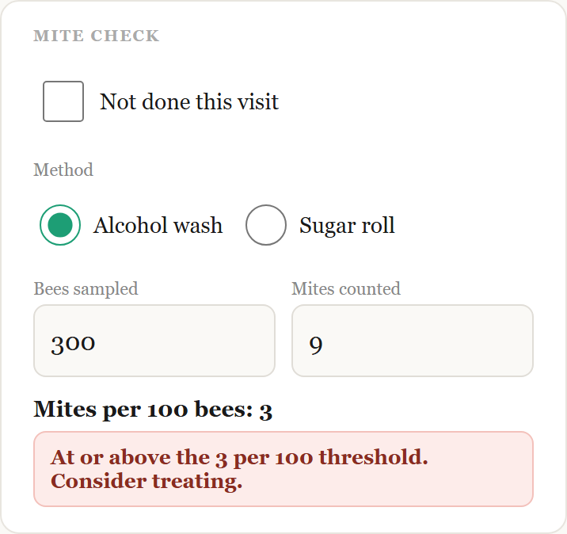
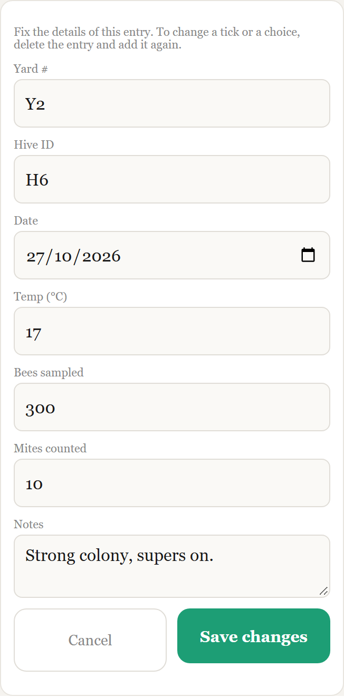
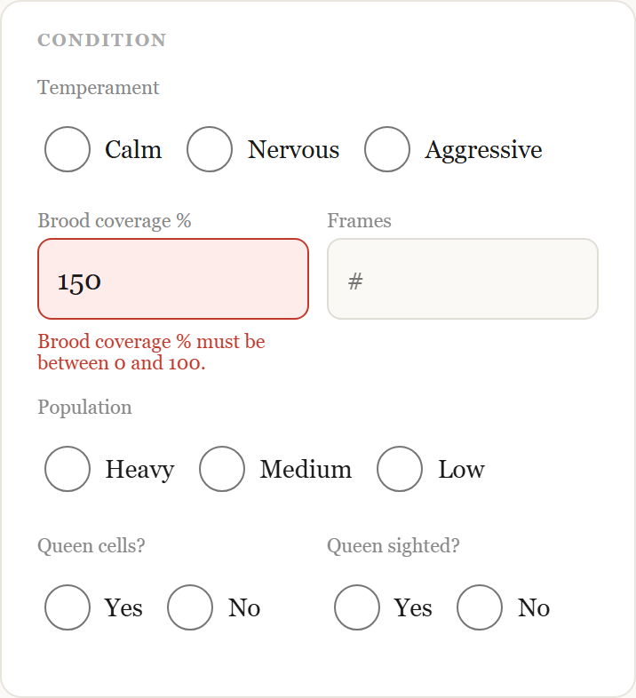

# BeeYardLog 🐝

[](https://github.com/mg20765/beeyardlog/actions/workflows/ci.yml)

I'm a beekeeper, and I built BeeYardLog because I kept running out of phone signal in the yard and my paper notes got messy.

It's an offline-first hive inspection logbook for mobile and tablet. No signal needed, no account, no server — everything lives on the device it's used on. Built for beekeepers ranging from a 2-hive hobbyist to a 2,000-hive commercial operation.

**Live app:** https://hive-logbook-maria.surge.sh (open it on a phone and use "Add to Home Screen").

## Screenshots

Sample data only; the hives shown are made up.

| Inspection form | Mite check |
| --- | --- |
|  |  |

| Inspection log | Fixing an entry |
| --- | --- |
|  |  |

| Checks before saving | Storage details |
| --- | --- |
|  |  |

## Highlights

- **Works with no signal.** A service worker caches the app, and every entry is saved on the device.
- **Doesn't lose your work.** A half-filled form is kept if the page reloads, deletes and "Clear log" ask first, and failed saves show an error instead of failing silently. If the app is open in two places (the installed app and a browser tab), they stay in step, so neither can make an incomplete backup.
- **Mite check.** Record an alcohol wash or sugar roll and get mites per 100 bees, with a clear hint when a count reaches the treatment threshold.
- **Easy to scan.** The log lists the newest entry first, can be searched once it grows, and flags a mite count that has reached the treatment line.
- **Protects your data.** JSON backup and restore (with a reminder after 10 new entries), Excel export, and a request to the browser not to clear stored data when the phone runs low on space.
- **Tested.** 179 unit tests (Vitest) and 99 end-to-end tests (Playwright) run on every push in GitHub Actions.

## How to use it

### Put it on your phone

1. Open https://hive-logbook-maria.surge.sh once **with signal**.
2. **iPhone (Safari):** tap Share, then **Add to Home Screen**. **Android (Chrome):** tap the ⋮ menu, then **Add to Home screen** or **Install app**.
3. Open it from the new icon. From now on it works with **no signal**.

### Log an inspection

1. Type a **Hive ID**. It's the only required field. Everything else is optional.
2. Fill in whatever you checked: weather, condition, mite check, treatments (including the AFB check), feeding, additions, food stores, extraction and notes.
3. Tap **+ Add to log**. If Temperament, Population, Queen sighted or Honey level are blank, you're asked once: **Go back** takes you to the first blank field, **Add anyway** saves it.
4. The entry appears at the top of the **Inspection log** (newest first; a search box appears once there are six or more). Tap it to see every field. Tap **Edit details** to fix a spelling mistake or a typed value (Hive ID, Yard #, date, notes and the other typed boxes), or tap ✕ to delete it (you're asked to confirm). Ticks and choices can't be edited: delete the entry and add it again.

Tapping a chosen round choice again clears it, so a mis-tap can be undone. If your phone reloads the page halfway through (a phone call, switching apps), your half-filled form comes back with a note. Tap **Discard draft** to start fresh.

### Mite check

Choose **Alcohol wash** or **Sugar roll**, enter the **bees sampled** (for example 300) and the **mites counted**. The app works out **mites per 100 bees** and shows a green note below the threshold, or a red "consider treating" note at or above **3 per 100**. That line is a reminder built into the app, not advice: use your own judgement and local guidance. If you didn't do a check, tick **Not done this visit**, so the log records that it was skipped rather than forgotten.

### Look after your data

Everything is stored **on your phone only**. There is no account and no server, so nobody else can see it, and nobody can recover it for you.

- **Backup (JSON)** saves a file with your whole log. Send it somewhere off the phone (email or cloud storage). A backup that stays on the phone is lost with the phone.
- **Restore backup** adds the entries in a backup file to the app. It never overwrites what's there, so don't restore the same file twice or you'll get duplicates.
- **Export all to Excel** makes a spreadsheet you can open on a computer. Numbers and dates are real numbers and dates, so you can add them up, sort and chart them.
- A banner reminds you to back up after 10 new or corrected entries.
- Clearing your browser data, using a different browser, or switching phones starts you with an empty log, so restore from a backup if you do.

## Getting started

### Prerequisites

- **Node.js 20.19+ or 22.12+** (required by Vite 8). Check with `node -v`.
- **npm** (comes with Node).
- **Git**, to clone the project.
- A modern browser (Chrome, Edge, Firefox, Safari).

### Local setup

```bash
# 1. Get the code
git clone https://github.com/mg20765/beeyardlog.git beeyardlog
cd beeyardlog

# 2. Install dependencies
npm install

# 3. (Optional) create your env file - no variables are required today
cp .env.example .env      # on Windows PowerShell: Copy-Item .env.example .env

# 4. Start the dev server
npm run dev
```

Vite prints a local URL (usually `http://localhost:5173`). Open it and the app is running; changes you save reload automatically.

### Environment variables

BeeYardLog needs **none** to run: it is offline-first and has no backend. `.env.example` is there as a template and documents the convention (variables must start with `VITE_`, and are public in the browser, so never put secrets in them). `.env` is git-ignored; `.env.example` is committed.

### Scripts

| Command | What it does |
| --- | --- |
| `npm run dev` | Local dev server with hot reload |
| `npm run dev:host` | Same, but reachable from your phone on the same wifi |
| `npm run build` | Production build into `dist/` |
| `npm run preview` | Serve the production build locally to check it |
| `npm run lint` | ESLint |
| `npm test` | Unit tests (Vitest) |
| `npm run test:e2e` | End-to-end tests (Playwright) |

### Running the tests

```bash
npm test                          # unit tests, fast, no browser
npx playwright install chromium   # one-off: download the test browser
npm run test:e2e                  # starts the dev server and clicks through the app
```

The unit tests cover the pure logic (validation, mite maths, the backup reminder, building the Excel file, drafts, search and sorting, syncing between open copies). The end-to-end suite clicks through the real app: saving and validation, editing an entry, backup and restore, Excel export, working offline, two open copies staying in step, the date after midnight, search, accessibility, button sizes, and the content-security policy. Playwright starts the dev server itself, so you don't need `npm run dev` running first.

### Troubleshooting

- **Port 5173 already in use:** the e2e config uses `--strictPort`, so stop whatever else is using it (usually another `npm run dev`).
- **`npm install` fails on an old Node:** upgrade Node to 20.19+ and retry.
- **Playwright says the browser is missing:** run `npx playwright install chromium`.
- **Old data looks missing:** data is stored per browser and per site address (`localhost:5173` and your deployed URL are separate logs).

### On a phone or tablet

Open the dev server URL on your phone/tablet browser (same wifi network, or use your machine's local IP) to test on a real device. To install it like an app, open it in the phone's browser and use "Add to Home Screen" — it has a manifest and icons set up for that.

## What it does

- **Inspection form**, organised into cards: Hive details (Yard #, Hive ID, date), Weather, Condition, Mite check, Treatments (varroa treatments + AFB check), Feeding, Additions, Food stores, Extraction, Notes.
- **AFB (American Foulbrood) tracking** is split into three deliberate steps so it can't be gamed: "AFB check performed" (routine, tick every time), "AFB signs found" (the real alert, styled in red), and, only shown if signs are found, "Reported to authority (required within 7 days)".
- **Mite check** for alcohol wash or sugar roll: works out mites per 100 bees, flags a count at or above the treatment line, and records "Not done" when a visit skipped it.
- **Checks before saving.** Hive ID is required. Clearly wrong values (brood coverage over 100, negative counts, oddly written numbers, impossible or future dates) are stopped: the screen jumps to the first problem and explains it beside the field. Temperament, Population, Queen sighted and Honey level are soft-checked with a one-tap "Add anyway".
- **Inspection log**, newest first, with a search box once it has six or more entries. Tap an entry to see every field, or **Edit details** to correct a typed value. A mite result shows on each row, red at or above the line.
- **Export all to Excel** produces a real `.xlsx`, one column per field, with real numbers and dates.
- **Backup (JSON) / Restore backup** is a separate, additive safety net. Backup downloads a snapshot of the whole log; Restore adds a snapshot back without wiping what's there. A banner reminds you after 10 new or corrected entries.

## How data is stored

All inspection data lives in **IndexedDB** (via the `idb` library), not localStorage. This matters at scale: localStorage caps out around 5MB per site (roughly 10,000 entries), which a busy commercial operation doing rounds every 3-4 weeks across thousands of hives could hit within a season. IndexedDB's practical ceiling is closer to hundreds of MB, so it scales from hobbyist to commercial without a rewrite.

If you have old data from before this switch (saved under `localStorage["hive_inspection_log"]`), it gets migrated into IndexedDB automatically, once, the first time the app loads.

If the app is open in two places at once (the installed app and a browser tab), they stay in step: each tells the other when the log changes, and each re-reads the log when it is shown again.

A few small pieces of data live in localStorage (not the log itself):
- `hive_last_backup_id`: the id of the newest entry in your last JSON backup, used to work out the "since backup" reminder. (Older versions stored a count in `hive_last_backup_count`; it is converted once automatically.)
- `hive_edits_since_backup`: how many already-backed-up entries have been corrected since, because the backup file still holds the old version.
- `yardbook_form_draft`: the half-filled form, so it survives a page reload. It is removed when you save the entry or tap "Discard draft". The key keeps the app's earlier working name on purpose, so drafts saved before the rename aren't lost.

## Project structure

```
src/
  App.jsx                    # composes the page; holds no logic itself
  App.css, index.css         # design tokens and styles
  main.jsx                   # entry point; registers the service worker in production

  NavBar/Header.jsx          # app title + "saved" pill

  components/                # one file per form card, plus the log and notices
    HiveDetailsSection.jsx, WeatherSection.jsx, ConditionSection.jsx,
    MiteCheckSection.jsx, TreatmentsSection.jsx, FeedingSection.jsx,
    AdditionsSection.jsx, FoodStoresSection.jsx, ExtractionSection.jsx,
    NotesSection.jsx
    InspectionLog.jsx        # newest-first list, search, mite chips
    EntryEditor.jsx          # "Edit details" panel
    ActionButtons.jsx        # add / export / backup / restore / clear
    BackupReminder.jsx, DraftNotice.jsx, MissingFieldsWarning.jsx,
    InputProblems.jsx, FieldError.jsx, problemsContext.js
    ui/                      # RadioGroup, LevelButtons

  hooks/useHiveLog.js        # all state and actions: form, log, drafts, sync, backup

  db/hiveDb.js               # IndexedDB layer (via idb) + legacy migration

  utils/                     # pure logic, each with unit tests
    hiveForm.js              # form shape + saved-row mapping
    validation.js            # checks before saving (numbers, dates, mites)
    mites.js                 # mites per 100 bees, treatment line
    editEntry.js             # which fields can be corrected, and how
    logView.js               # newest-first sorting and search
    excel.js, exportRows.js  # the Excel export (real numbers and dates)
    backup.js, backupReminder.js, draft.js, persist.js, sync.js, date.js, omitId.js

public/                      # service worker (sw.js), manifest, icons
tests/                       # Playwright end-to-end tests
scripts/                     # icon generation
docs/screenshots/            # README images (made-up sample data)
.github/workflows/ci.yml     # lint, unit tests, build and end-to-end tests on every push
```

`App.jsx` only composes components and wires props from `useHiveLog()`. If you want to change what a field does, `useHiveLog.js`, `hiveForm.js` and `validation.js` are the files that matter; to change how a section looks, its component in `components/` is the only file you need.

## Known limitations / things to watch

- **Mobile browser data isn't automatically backed up anywhere.** IndexedDB survives app updates and phone restarts, but not a factory reset, "clear browsing data," or switching browsers/phones. The backup reminder exists because of this: encourage regular JSON backups, and get that file off the phone (cloud storage, email), since a backup sitting only in Downloads dies with the phone too.
- **No sync between devices.** Each phone/browser has its own independent log. (Two open copies on the *same* phone do stay in step.) If several people log for one operation, each device's data is separate: combine them with Restore backup on one device, or keep separate exports.
- **Tested on Android (Chrome) and desktop browsers; iPhone Safari testing is still to do.** Installing and offline use may behave differently on iOS. Safari can clear a website's stored data after about a week of not being used, unless the app has been added to the Home Screen, so on an iPhone keep it on the Home Screen and back up regularly.
- **AFB reporting deadlines vary by region.** The "7 days" language matches NZ's notifiable-disease requirement; adjust the label in `TreatmentsSection.jsx` if a different jurisdiction's rule applies.
- **The mite treatment line is fixed at 3 per 100 bees** (a constant in `src/utils/mites.js`). It is a reminder, not advice.

## Ideas for later

- A "Summary" sheet in the Excel export (entries per hive, latest mite result).
- The mite treatment line as a setting rather than a constant.
- Undo for deleting an entry, and a warning for a duplicate Hive ID on the same date.
- A "new version available, reload" prompt when the app updates.
- Voice or spoken reminders for hands-busy moments (gloves on, mid-inspection).
- A two-column layout for landscape tablets.

## A note on dependencies

The Excel export uses SheetJS (`xlsx`). The copy on npm is out of date (0.18.5, with known security advisories), so BeeYardLog installs the current release (0.20.3) from SheetJS's own site, as their documentation recommends, and `npm audit` is clean. It only **creates** spreadsheets from your own data and never opens one (Restore uses JSON backups).

## Thanks

Thank you to Mel and Levi for testing BeeYardLog on iPhone (an iPhone 13 mini and an iPhone 15) and for telling me honestly what felt right and what didn't. Their feedback on button sizes and the number pad shaped the app.

## Licence

BeeYardLog is released under the [MIT Licence](LICENSE). You're welcome to use it, learn from it and build on it; please keep the copyright notice.
