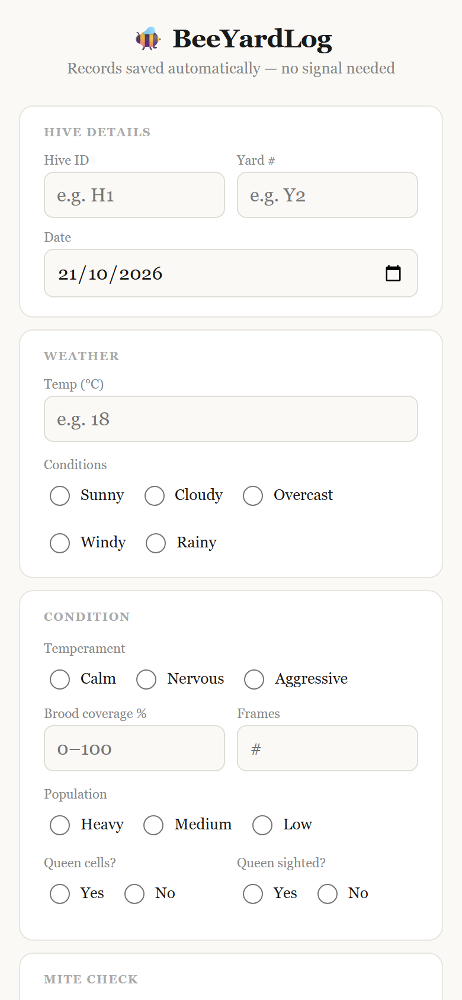
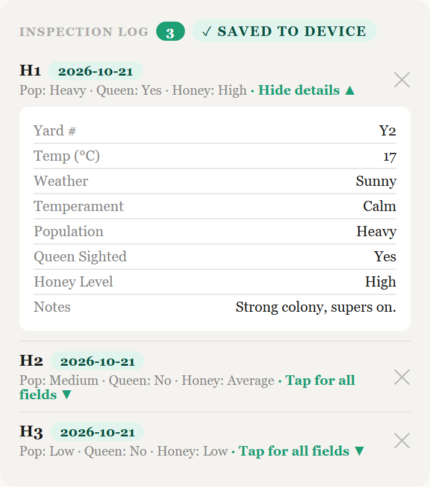
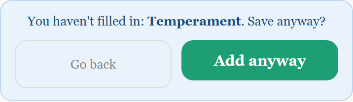
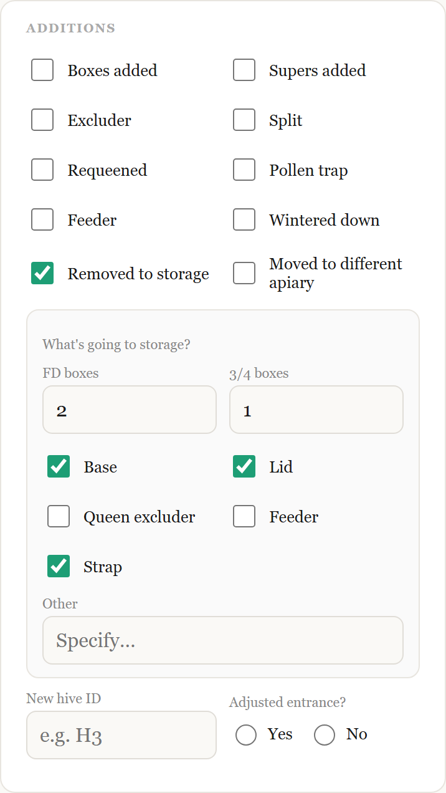

# BeeYardLog 🐝

[](https://github.com/mg20765/beeyardlog/actions/workflows/ci.yml)

An offline-first hive inspection logbook for mobile and tablet. No signal needed, no account, no server — everything lives on the device it's used on. Built for beekeepers ranging from a 2-hive hobbyist to a 2,000-hive commercial operation.

**Live app:** https://hive-logbook-maria.surge.sh (open it on a phone and use "Add to Home Screen").

## Screenshots

Sample data only; the hives shown are made up.

| Inspection form | Inspection log |
| --- | --- |
|  |  |

| Save check | Storage details |
| --- | --- |
|  |  |

## Highlights

- **Works with no signal.** A service worker caches the app, and every entry is saved on the device.
- **Doesn't lose your work.** A half-filled form is kept if the page reloads, deletes and "Clear log" ask first, and failed saves show an error instead of failing silently.
- **Mite check.** Record an alcohol wash or sugar roll and get mites per 100 bees, with a clear hint when a count reaches the treatment threshold.
- **Protects your data.** JSON backup and restore (with a reminder after 10 new entries), Excel export, and a request to the browser not to clear stored data when the phone runs low on space.
- **Tested.** 82 unit tests (Vitest) and 30 end-to-end tests (Playwright) run on every push in GitHub Actions.

## Getting started

### Prerequisites

- **Node.js 20.19+ or 22.12+** (required by Vite 8). Check with `node -v`.
- **npm** (comes with Node).
- **Git**, to clone the project.
- A modern browser (Chrome, Edge, Firefox, Safari).

### Local setup

```bash
# 1. Get the code
git clone https://github.com/mg20765/beeyardlog.git beeyardlog
cd beeyardlog

# 2. Install dependencies
npm install

# 3. (Optional) create your env file - no variables are required today
cp .env.example .env      # on Windows PowerShell: Copy-Item .env.example .env

# 4. Start the dev server
npm run dev
```

Vite prints a local URL (usually `http://localhost:5173`). Open it and the app is running; changes you save reload automatically.

### Environment variables

BeeYardLog needs **none** to run: it is offline-first and has no backend. `.env.example` is there as a template and documents the convention (variables must start with `VITE_`, and are public in the browser, so never put secrets in them). `.env` is git-ignored; `.env.example` is committed.

### Scripts

| Command | What it does |
| --- | --- |
| `npm run dev` | Local dev server with hot reload |
| `npm run dev:host` | Same, but reachable from your phone on the same wifi |
| `npm run build` | Production build into `dist/` |
| `npm run preview` | Serve the production build locally to check it |
| `npm run lint` | ESLint |
| `npm test` | Unit tests (Vitest) |
| `npm run test:e2e` | End-to-end tests (Playwright) |

### Running the tests

```bash
npm test                          # unit tests, fast, no browser
npx playwright install chromium   # one-off: download the test browser
npm run test:e2e                  # starts the dev server and clicks through the app
```

The e2e suite covers: add an inspection, Hive ID required, storage fields show, delete an entry, and data surviving a reload. Playwright starts the dev server itself, so you don't need `npm run dev` running first.

### Troubleshooting

- **Port 5173 already in use:** the e2e config uses `--strictPort`, so stop whatever else is using it (usually another `npm run dev`).
- **`npm install` fails on an old Node:** upgrade Node to 20.19+ and retry.
- **Playwright says the browser is missing:** run `npx playwright install chromium`.
- **Old data looks missing:** data is stored per browser and per site address (`localhost:5173` and your deployed URL are separate logs).

### On a phone or tablet

Open the dev server URL on your phone/tablet browser (same wifi network, or use your machine's local IP) to test on a real device. To install it like an app, open it in the phone's browser and use "Add to Home Screen" — it has a manifest and icons set up for that.

## What it does

- **Inspection form**, organized into cards: Hive details, Weather, Condition, Treatments (varroa/mite meds + AFB check), Feeding, Additions, Food stores, Extraction, Notes.
- **AFB (American Foulbrood) tracking** is split into three deliberate steps so it can't be gamed: "AFB check performed" (routine, tick every time), "AFB signs found" (the real alert, styled in red), and — only shown if signs are found — "Reported to authority (required within 7 days)".
- **Inspection log** at the bottom, tap any entry to expand and see every field that was filled in (not just the 3-field summary).
- **Validation before saving**: Hive ID is required (hard stop, can't save without it). Temperament, Population, Queen sighted, and Honey level are soft-checked — if any are blank you get a one-tap "Add anyway" or "Go back" (which scrolls straight to the first blank field).
- **Export all to Excel** — produces a real `.xlsx` with every logged inspection, one column per field, ready to open in Excel/Sheets.
- **Backup (JSON) / Restore backup** — a separate, additive safety net (not for viewing — that's what Excel export is for). Backup downloads a `.json` snapshot of the whole log; Restore reads one back in without wiping what's already there. Useful for moving your log to a new phone.
- **Backup reminder banner** — appears once 10+ inspections have been logged since your last JSON backup, so data isn't only sitting on one device.

## How data is stored

All inspection data lives in **IndexedDB** (via the `idb` library), not localStorage — this matters at scale: localStorage caps out around 5MB per site (roughly 10,000 entries), which a busy commercial operation doing rounds every 3-4 weeks across thousands of hives could hit within a season. IndexedDB's practical ceiling is closer to hundreds of MB, so it scales from hobbyist to commercial without a rewrite.

If you have old data from before this switch (saved under `localStorage["hive_inspection_log"]`), it gets migrated into IndexedDB automatically, once, the first time the app loads.

Two small pieces of data live in localStorage (not the log itself):
- `hive_last_backup_id` — the id of the newest entry in your last JSON backup, used to work out the "N since backup" reminder. (Older versions stored a count in `hive_last_backup_count`; it is converted once automatically.)
- `yardbook_form_draft` — the half-filled form, so it survives a page reload. It is removed when you save the entry or tap "Discard draft".

## Project structure

```
src/
  App.jsx                  # top-level composition, orchestrates everything
  App.css                  # shared design tokens + section/button/log styles
  index.css                # global reset
  main.jsx                 # React entry point

  NavBar/
    Header.jsx / .css      # app title + "saved" pill

  components/
    HiveDetailsSection.jsx
    WeatherSection.jsx
    ConditionSection.jsx
    TreatmentsSection.jsx  # mite treatments + AFB check/signs/reported
    FeedingSection.jsx     # syrup/dry feed/patties/nutrition boost
    AdditionsSection.jsx
    FoodStoresSection.jsx
    ExtractionSection.jsx
    NotesSection.jsx
    InspectionLog.jsx      # expandable log list
    ActionButtons.jsx      # add/export/backup/restore/clear
    BackupReminder.jsx     # "N since backup" banner
    MissingFieldsWarning.jsx
    ui/
      RadioGroup.jsx
      LevelButtons.jsx     # High/Average/Low pill buttons

  hooks/
    useHiveLog.js           # all state, validation, and actions live here

  db/
    hiveDb.js               # IndexedDB layer (via idb) + legacy migration

  utils/
    hiveForm.js              # initialForm() shape + formToRow() column mapping
    backup.js                 # JSON backup download/read
    omitId.js
```

`App.jsx` only composes components and wires props from `useHiveLog()` — it holds no logic itself. If you want to change what a field does, `useHiveLog.js` and `hiveForm.js` are the two files that matter; if you want to change what a section looks like, its component in `components/` is the only file you need.

## Known limitations / things to watch

- **Mobile browser data isn't automatically backed up anywhere.** IndexedDB survives app updates and phone restarts, but not a factory reset, "clear browsing data," or switching browsers/phones. The backup reminder exists because of this — encourage regular JSON backups, and get that file off the phone (cloud storage, email) since a backup sitting only in Downloads dies with the phone too.
- **No multi-device sync.** Each phone/browser has its own independent log. If a commercial operation has multiple people logging, each device's data is separate — combine them via Restore backup on one device, or just keep separate exports.
- **AFB reporting deadlines vary by region.** The "7 days" language matches NZ's notifiable-disease requirement; adjust the label in `TreatmentsSection.jsx` if a different jurisdiction's rule applies.

## Ideas discussed but not (yet) built

- Switching the storage layer to Dexie.js instead of `idb`, for built-in filtering/search (e.g. "show me hive H23's history"). Not needed yet since even 20,000+ rows filter fast enough in plain JS at this app's scale — worth revisiting if a search/filter UI gets requested.
- Voice/spoken reminders for hands-busy moments (gloves on, mid-inspection). Skipped for the backup reminder specifically since that's a post-inspection nudge, not needed mid-task — but a real option if a "confirm save" voice prompt is ever wanted while hands are full.
